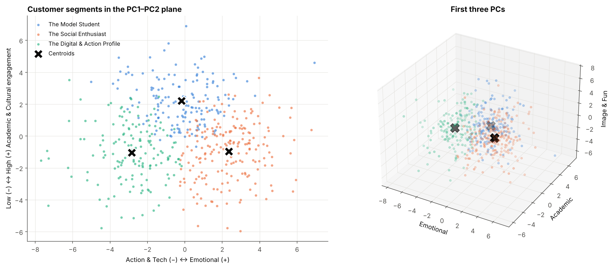
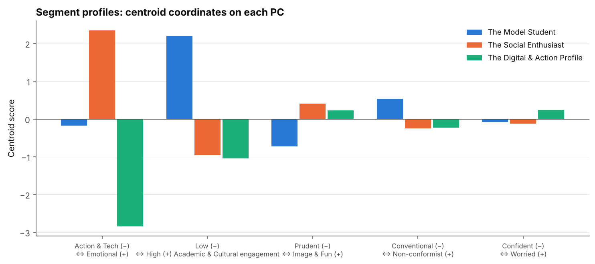
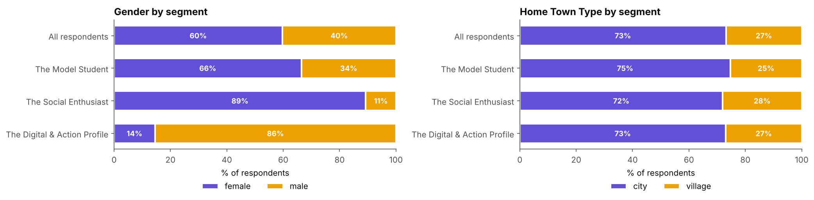

# Customer Segmentation with PCA & k-Means

Unsupervised analysis of a lifestyle survey: **93 questions → 5 interpretable lifestyle axes → 3 customer profiles**.
The same workflow a marketing team uses to turn a long questionnaire into a few actionable segments.



## Key results

| Segment | Share | Profile |
|---|---|---|
| **The Model Student** | 31% | Highest *Academic & Cultural* engagement (history, art, languages, classical music); prudent with money |
| **The Social Enthusiast** | 39% | Highest *Emotional* sensitivity, oriented to image, fun and social life |
| **The Digital & Action Profile** | 30% | Strong *Action & Tech* side (sci-fi and action movies, PCs, cars), low academic engagement |

- **Dimensionality reduction:** PCA reduced 93 standardized features to 5 components, each interpreted and named from its loadings.
- **Model selection:** *k* = 3 chosen by maximizing the silhouette score over *k* ∈ {3, …, 10}.
- **External validation:** demographics were never used for training, yet gender splits sharply between segments (89% female in *Social Enthusiast*, 86% male in *Digital & Action*). Home town type (city vs village) is neutral across all segments.
- **Internal validation:** overall silhouette 0.18. That is moderate and typical for survey data, so the segments are best read as tendencies, not hard boundaries.

<p align="center">
  
</p>

<p align="center">
  
</p>

## Approach

1. **Preprocessing**: ordinal encoding of ordered categorical answers (e.g. *never < social drinker < drink a lot*), then standardization with `StandardScaler`
2. **Variance analysis**: shows why scaling is needed before PCA ([plot](images/feature_variance.png), [cumulative variance](images/cumulative_variance.png))
3. **PCA**: 5 components, each named from its loadings ([example: PC1](images/pc1_loadings.png))

   | PC | Lifestyle axis |
   |---|---|
   | PC1 | Action & Tech ↔ Emotional sensitivity |
   | PC2 | Academic & Cultural engagement |
   | PC3 | Prudent ↔ Image & Fun |
   | PC4 | Conventional ↔ Non-conformist |
   | PC5 | Confident ↔ Worried |

4. **k-Means clustering** in PCA space, with silhouette-based choice of *k* ([plot](images/silhouette_vs_k.png))
5. **Evaluation**: external (gender, home town type) and internal ([silhouette analysis](images/silhouette.png))

## Repository structure

```
├── data/
│   └── survey_responses.csv          # 506 respondents × (93 features + 10 demographics)
├── notebooks/
│   └── customer_segmentation.ipynb   # full analysis, with outputs
├── images/                           # figures exported by the notebook
├── requirements.txt
└── README.md
```

## How to run

```bash
git clone https://github.com/flaviofrasca/customer-segmentation-pca-kmeans.git
cd customer-segmentation-pca-kmeans
pip install -r requirements.txt
jupyter notebook notebooks/customer_segmentation.ipynb
```

## Tech stack

Python · pandas · NumPy · scikit-learn · Matplotlib · Jupyter

## Data

Subset of the [Young People Survey](https://www.kaggle.com/datasets/miroslavsabo/young-people-survey) (M. Sabo, 2013): young respondents rated their interests, tastes, habits and personality traits on a 1–5 scale.

## Possible extensions

- Gaussian Mixture Models for soft segment membership
- Factor Analysis or Varimax rotation for cleaner, more separable axes
- A classifier that assigns new respondents to a segment from a shortened questionnaire

## Authors

**Flavio Frasca** and **Alessandra Di Foggia**. Developed as a project for the *Computational Linear Algebra for Large Scale Problems* course (Politecnico di Torino, 2025/26).
